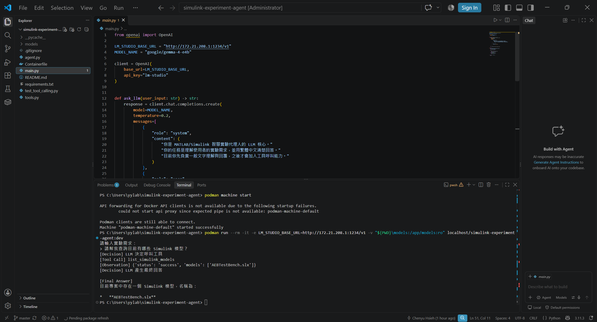
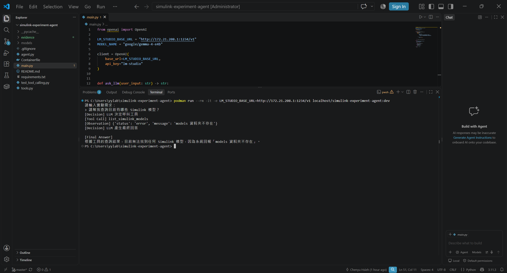
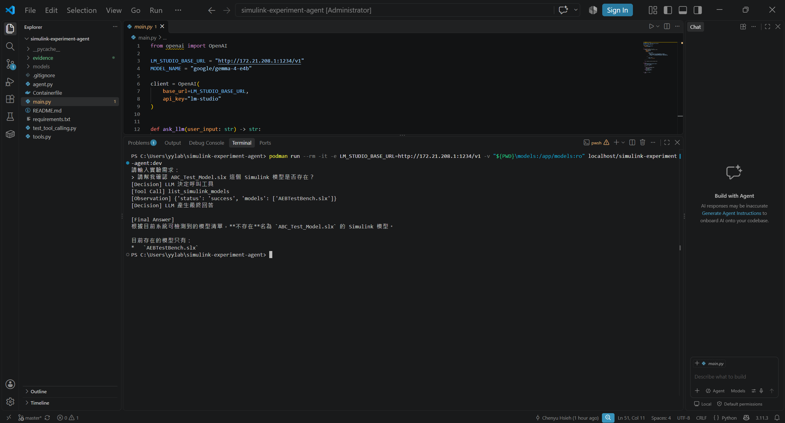
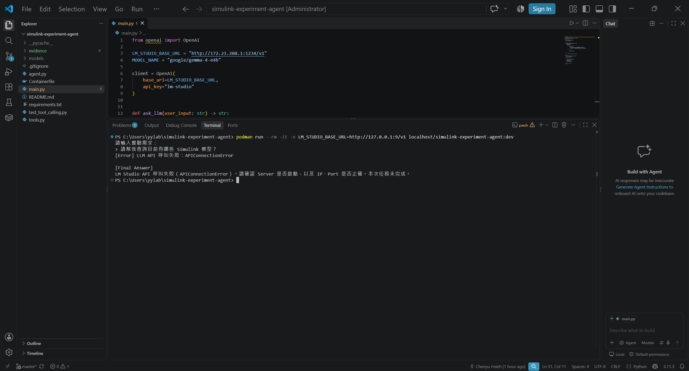

# MATLAB/Simulink 智慧實驗代理人

**An LLM-Based Intelligent Experiment Agent for MATLAB/Simulink with Tool Calling**

> 人工智慧代理人原理及實務｜指定作業 2：可執行 Agent + Tool / ReAct Agent  
> 專案階段：最小可執行雛形（MVP）  
> 狀態：已完成模型檔案查詢、LLM Tool Calling、LangGraph Workflow 與 Podman 執行；**尚未執行真正的 MATLAB/Simulink 模擬**。

## 1. 專案概述

本專案以大型語言模型（LLM）、LangGraph 與 Tool Calling 建立 MATLAB/Simulink 智慧實驗代理人。目標是讓使用者以自然語言提出實驗需求，由 Agent 判斷需要使用的工具，執行受控的操作，並根據實際工具結果產生回答。

本專案延續指定作業 1 的規劃：未來希望支援查詢與切換 Scenario、驗證模型參數、執行 MATLAB/Simulink 模擬，以及比較 Yaw Rate、Steering Angle 和 Vehicle Velocity 等實驗訊號。

**指定作業 2 的實際完成範圍**為模型檔案查詢（Model Inspector）與完整工具調用流程。目前只能確認 `.slx` 檔案是否存在，**不能**因此宣稱模型已成功載入、通過驗證或完成模擬。

## 2. 系統架構

```text
使用者自然語言輸入
         |
         v
LangGraph Agent（Podman 容器）
         |
         v
Gemma 4 E4B（Windows / LM Studio API）
         |
         v
判斷是否需要 Tool Calling
         |
         v
Model Inspector（容器內 Python Tool）
         |
         v
Observation（真實檔案查詢結果）
         |
         v
Gemma 4 E4B 根據結果形成回答
         |
         v
Final Answer
```

**部署邊界：**

- **Windows 主機：** LM Studio 和 Gemma 4 E4B（LLM Server）。
- **Podman 容器：** Python、LangGraph Agent、Tool 執行邏輯。
- **模型目錄：** Windows 的 `models/` 透過唯讀 Volume Mount 掛載至容器內 `/app/models`。
- **通訊方式：** Podman 中的 Python 透過 HTTP API 呼叫 Windows 上的 LM Studio。
- **MATLAB Runner：** 本階段尚未實作；未來預計由具備 MATLAB/Simulink 授權的 Windows 主機執行，再與 Agent 透過受控介面通訊。此部分的部署邊界仍須進一步確認。

## 3. 使用技術

| 技術 | 用途 |
|---|---|
| Python 3.11 | Agent 與 Tool 程式語言 |
| LangGraph | 定義 LLM 與 Tool 節點、條件路由和執行循環 |
| Gemma 4 E4B | 自然語言理解、工具選擇與結果說明 |
| LM Studio | 在 Windows 上提供本機 LLM API |
| OpenAI Python SDK | 透過相容 API 呼叫 LM Studio |
| Podman / WSL2 | 容器化建置與執行 Agent |
| MATLAB/Simulink `.slx` | Model Inspector 的實際查詢對象；尚未用於模擬執行 |

`requirements.txt` 目前包含 `langgraph` 與 `openai`；套件由 `Containerfile` 在建置時安裝。現階段尚未固定套件版本，後續可補強版本鎖定以提高可重現性。

## 4. 已實作功能與 Tool 定義

### 4.1 Model Inspector

- **Tool 名稱：** `list_simulink_models`
- **目的：** 查詢專案 `models/` 目錄下實際存在的 `.slx` 模型檔案。
- **輸入：** 無參數（空物件 `{}`）。
- **輸出：** Python 字典，包含 `status`、`models`（成功時）與視情況提供的 `message`。
- **實際操作：** 使用 Python `pathlib` 掃描檔案；不是由 LLM 自行產生模型清單。

正常輸出範例：

```python
{'status': 'success', 'models': ['AEBTestBench.slx']}
```

資料夾不存在時：

```python
{'status': 'error', 'message': 'models 資料夾不存在'}
```

資料夾存在但沒有 `.slx` 時：

```python
{'status': 'success', 'models': [], 'message': '目前沒有找到 Simulink 模型'}
```

**限制：** 此工具僅列出資料夾第一層的 `.slx` 檔名，不會解析模型內容、檢查相依檔案、切換 Scenario 或執行 MATLAB。

### 4.2 LangGraph Agent

目前的 `agent.py` 具有以下工作流程：

1. 接收使用者自然語言輸入。
2. 使用 LM Studio API 呼叫 Gemma 4 E4B。
3. 由 LLM 判斷是否發出 `list_simulink_models` Tool Call。
4. 由 Python 程式實際執行工具並回傳 Observation。
5. 再次呼叫 LLM，根據 Observation 產生最終回答。

程式另包含基本的工具名稱／參數檢查、LLM 決策次數上限及 API 呼叫失敗處理。這些機制不代表所有錯誤情境都已涵蓋。

## 5. 執行環境與必要條件

本次已驗證的開發環境：

- Windows 11（x64）
- AMD Ryzen 5 3600、16 GB RAM
- NVIDIA GeForce RTX 2080（8 GB VRAM）
- Python 3.11.3（Windows 開發環境）
- Podman 5.x、WSL2
- LM Studio 與 `google/gemma-4-e4b`
- PowerShell、VS Code

**必要條件：** Podman Machine 可執行、LM Studio 已載入模型且 Local Server 處於 Running、Podman 容器可連線至 LM Studio API。

## 6. 建置與執行

### 6.1 準備 Podman

第一次使用時，須確認 BIOS 已啟用 CPU 硬體虛擬化，Windows 可使用 WSL2，並已建立 Podman Machine。

若 Podman Machine 尚未建立，可執行：

```powershell
podman machine init
podman machine start
```

若已建立但尚未啟動，只需執行：

```powershell
podman machine start
```

可用以下測試確認 Podman 能執行容器：

```powershell
podman run --rm docker.io/library/hello-world
```

### 6.2 準備 LM Studio

1. 安裝並開啟 LM Studio。
2. 下載並載入 Gemma 4 E4B（本次使用的模型 ID：`google/gemma-4-e4b`）。
3. 在 Developer 頁面啟動 Local Server，確認狀態為 **Running**，Port 為 `1234`。
4. 在 Windows PowerShell 查詢可用模型：

```powershell
((Invoke-RestMethod http://127.0.0.1:1234/v1/models).data).id
```

本次成功查得 `google/gemma-4-e4b`。若 Podman 需要跨 Windows 主機網路存取 API，可在**可信任的私人網路**中啟用 LM Studio 的 **Serve on Local Network**，並確認 Windows 防火牆限制；勿將 API 直接公開至網際網路。

### 6.3 取得 Windows WSL 網卡 IP

本次開發過程發現 `host.containers.internal:1234` 無法連線，因此改用 Windows 的 WSL 虛擬網卡 IP。

在 **Windows PowerShell** 執行：

```powershell
Get-NetIPAddress -InterfaceAlias "vEthernet (WSL)" -AddressFamily IPv4 | Select-Object -ExpandProperty IPAddress
```

本次取得 `172.21.208.1`。**這是測試環境的位址，不是固定值**；其他電腦、不同網卡名稱或 WSL 重新啟動後應重新確認。

若找不到相同介面名稱，可先檢查本機的 IPv4 網卡資訊：

```powershell
Get-NetIPAddress -AddressFamily IPv4 | Select-Object InterfaceAlias, IPAddress
```

### 6.4 準備 Simulink 模型

在專案根目錄建立 `models/` 資料夾，並放入有權使用的 `.slx` 模型檔案。

本專案實際測試使用 MathWorks AEB 範例中的 `AEBTestBench.slx`，但**模型檔案不包含在 GitHub Repository**，需要由執行者自行準備。缺少模型檔案時仍可測試錯誤處理流程。

### 6.5 建置 Podman 映像檔

在專案根目錄的 **PowerShell** 執行：

```powershell
podman build -t simulink-experiment-agent:dev -f Containerfile .
```

成功時會出現類似：

```text
Successfully tagged localhost/simulink-experiment-agent:dev
```

### 6.6 執行 Agent

確保 LM Studio Server 正在執行，並將以下指令中的 `172.21.208.1` 替換成實際查到的主機 IP：

```powershell
podman run --rm -it -e LM_STUDIO_BASE_URL=http://172.21.208.1:1234/v1 -v "${PWD}\models:/app/models:ro" localhost/simulink-experiment-agent:dev
```

其中：

- `--rm`：容器結束後移除容器。
- `-it`：允許從終端機互動輸入。
- `-e LM_STUDIO_BASE_URL=...`：指定 LM Studio API 位址。
- `-v "${PWD}\models:/app/models:ro"`：將模型資料夾以唯讀方式掛載。
- `localhost/simulink-experiment-agent:dev`：本機建置的映像檔名稱。

啟動後輸入：

```text
請幫我查詢目前有哪些 Simulink 模型？
```

如果本機還沒有 `models/` 目錄，請先建立；否則 Volume Mount 可能無法成功掛載。

## 7. Agent 執行追蹤（Agent Trace）

以下是本次實際成功執行的案例：

**User Input：**

```text
請幫我查詢目前有哪些 Simulink 模型？
```

**Decision → Tool Call → Observation → Final Answer：**

```text
[Decision] LLM 決定呼叫工具
[Tool Call] list_simulink_models
[Observation] {'status': 'success', 'models': ['AEBTestBench.slx']}
[Decision] LLM 產生最終回答

[Final Answer]
目前專案中存在一個 Simulink 模型，名稱為：AEBTestBench.slx
```

這個結果證明在上述情境中，LLM 發出 Tool Call，容器內的 Python Tool 真正讀取檔案清單，而 LLM 根據工具結果回答。**此流程未執行 MATLAB 模擬。**

## 8. 測試紀錄與重現方式

| ID | 測試情境 | 預期行為 | 本次結果 |
|---|---|---|---|
| T01 | 查詢現有 `AEBTestBench.slx` | 呼叫 Tool、取得真實清單並回答 | Pass |
| T02 | 未掛載 `models/` | Tool 回傳目錄不存在，Agent 說明錯誤 | Pass |
| T03 | 查詢不存在的 `ABC_Test_Model.slx` | 根據工具清單回答不存在，不虛構模型 | Pass |
| T04 | LM Studio API 連線失敗 | 捕捉 API 錯誤，清楚回報任務未完成 | Pass |

上述 Pass 為本次開發環境已觀察到的結果，並非宣稱所有電腦或模型輸出皆固定一致。

### T01：正常模型查詢

執行（主機 IP 請依第 6.3 節調整）：

```powershell
podman run --rm -it -e LM_STUDIO_BASE_URL=http://172.21.208.1:1234/v1 -v "${PWD}\models:/app/models:ro" localhost/simulink-experiment-agent:dev
```

輸入：`請幫我查詢目前有哪些 Simulink 模型？`

預期：可看到 `[Tool Call] list_simulink_models` 和包含 `AEBTestBench.slx` 的 Observation。

### T02：Failure Case 1 — 模型資料夾不存在

**測試方法：** 故意不掛載 `models/`，但保持 LM Studio 可連線。

```powershell
podman run --rm -it -e LM_STUDIO_BASE_URL=http://172.21.208.1:1234/v1 localhost/simulink-experiment-agent:dev
```

輸入：`請幫我查詢目前有哪些 Simulink 模型？`

本次實際結果：

```text
[Tool Call] list_simulink_models
[Observation] {'status': 'error', 'message': 'models 資料夾不存在'}
[Decision] LLM 產生最終回答

[Final Answer]
根據工具的查詢結果，目前無法找到任何 Simulink 模型，因為系統回報「models 資料夾不存在」。
```

**原因：** Tool 無法存取預期的模型目錄。  
**處理方式：** Tool 回傳 `error`，Agent 依實際錯誤訊息回覆，未自行虛構模型。

### T03：負向查詢 — 指定模型不存在

使用與 T01 相同的啟動指令（需掛載含 `AEBTestBench.slx` 的 `models/`），輸入：

```text
請幫我確認目前專案中是否存在 ABC_Test_Model.slx 模型？
```

本次實際結果：Tool 回傳 `AEBTestBench.slx`，Agent 回答 `ABC_Test_Model.slx` 不存在。

**說明：** T03 是正常完成的負向查詢，不屬於工具執行失敗。

### T04：Failure Case 2 — LLM API 無法連線

**測試方法：** 故意將 API 位址設為容器內沒有服務的 `127.0.0.1:9`，不需要關閉實際 LM Studio Server。

```powershell
podman run --rm -it -e LM_STUDIO_BASE_URL=http://127.0.0.1:9/v1 localhost/simulink-experiment-agent:dev
```

輸入：`請幫我查詢目前有哪些 Simulink 模型？`

本次實際結果：

```text
[Error] LLM API 呼叫失敗：APIConnectionError

[Final Answer]
LM Studio API 呼叫失敗（APIConnectionError）。請確認 Server 是否啟動，以及 IP、Port 是否正確。本次任務未完成。
```

**原因：** 指定的 API 位址不可連線。  
**處理方式：** `agent.py` 捕捉例外並產生失敗回覆，未發生未處理的 Python Traceback。

> 建議繳交時保留 T01～T04 的終端機截圖作為測試證據。本文僅記錄本次已觀察到的輸出；截圖檔案需另外提供，不能以文字紀錄代替實際圖片。

## 9. 目前限制與已知問題

1. **未整合 MATLAB Runner：** 尚無法真正開啟或執行 Simulink 模型。
2. **未解析 `.slx` 內部：** Model Inspector 只掃描檔名，不確認模型內容與相依性。
3. **未支援 Scenario 切換或參數驗證：** 使用者提出這類要求時，不應宣稱已完成操作。
4. **未擷取模擬訊號：** 尚無 Yaw Rate、Steering Angle、Vehicle Velocity 的真實模擬數據或圖表比較。
5. **依賴本機 API：** LM Studio 必須保持 Running；WSL/Windows IP 可能更動。
6. **LLM 仍有不確定性：** 工具選擇與最終用語可能隨模型設定變化，需要持續測試。
7. **可重現性待加強：** Python 套件目前尚未固定精確版本；未來應補上版本鎖定、更多自動化測試及執行證據。

## 10. 後續開發規劃

本專案沿用同一主題持續擴充，而非另做新專案：

- **指定作業 3：** 擴充 Scenario 查詢、參數驗證及 Agent 的錯誤處理與評估；以測試案例比較改進前後表現。
- **期末專案：** 規劃整合受控的 MATLAB Runner，在具有授權與相依檔案的主機上執行真正 Simulink 模擬。
- **後續分析能力：** 擷取並比較 Yaw Rate、Steering Angle 與 Vehicle Velocity，產生實驗紀錄與報告。

上述均為後續規劃，**不是指定作業 2 已完成的功能**。

## 11. 安全與使用注意事項

- 僅使用可信任及已核准的模型與工具。
- 不允許 LLM 直接執行任意 MATLAB 指令。
- 模型檔案未包含於 GitHub，需由使用者自行合法取得。
- 未執行 MATLAB 模擬時，不可將 LLM 文字描述當作真實模擬結果。
- LM Studio Local Server 只應在可信任的網路環境下提供連線，避免對外公開 API。
- `models/` 使用唯讀掛載，降低誤修改模型檔案的風險。

## 12. AI 輔助開發與學習紀錄

### 12.1 AI 工具使用方式

本專案使用 ChatGPT 輔助理解 AI Agent 技術、討論架構、提供 Python 程式範例、整理部署流程及分析錯誤訊息。核心程式範例有使用 AI 協助產生；並非宣稱所有程式碼均由學生獨立撰寫。

實際開發過程採取「提出需求 → 取得 AI 建議 → 在本機實作與執行 → 回報實際輸出 → 排查與修正 → 記錄測試結果」的方式。開發者於 Windows/VS Code/Podman 環境進行設定、模型檔案準備、程式執行及結果確認。

### 12.2 AI 協作與問題解決案例

**案例一：Podman 無法啟動**

最初執行 `podman machine init` 時，出現 WSL2 虛擬化無法啟動的錯誤。透過查詢 BIOS/Windows 設定並將錯誤提供 AI 協助判斷，確認 AMD SVM Mode 未啟用。調整後重新執行 Podman Machine 初始化及 `hello-world` 測試成功。此過程學習到 CPU 虛擬化、WSL2 與容器執行環境之間的關係。

**案例二：Podman 連不上 LM Studio**

容器透過 `host.containers.internal:1234` 呼叫 LM Studio 時發生：

```text
ConnectionRefusedError: [Errno 111] Connection refused
```

先確認 LM Studio Server 是否 Running，以及是否監聽 `0.0.0.0:1234`，再檢查 Windows WSL 虛擬網卡。最後使用當時查到的 `172.21.208.1:1234` 成功取得模型清單。此過程認識到容器與 Windows 主機各有網路環境，不能直接將容器內 `127.0.0.1` 視為 Windows 主機。

**案例三：Tool Calling 與真正的 Tool Execution**

先建立 `list_simulink_models()` Python 函式，實際掃描 `.slx` 檔案；再透過 ChatGPT 提供的測試方式，驗證 Gemma 4 E4B 能回傳：

```text
Finish Reason: tool_calls
function:
    name: list_simulink_models
    arguments: {}
```

之後使用 LangGraph 串接「LLM 決策 → Python Tool 執行 → Observation → LLM 回答」，並在本機成功測試。此過程有助於區分：**LLM 提出工具呼叫請求；真正執行檔案查詢的是 Python 程式。**

### 12.3 測試與驗證方法

本階段依據真實 Tool 輸出，分別測試正常模型查詢、缺少模型資料夾、指定模型不存在、LLM API 無法連線四種情境。測試輸入、觀察結果及重現指令列於第 8 節。

這些測試用於確認 Agent 不僅能生成合理文字，也能實際調用工具，並在可預期的異常下提供明確結果。尚未涵蓋所有可能錯誤，後續仍需擴充自動化測試。

### 12.4 本階段學習重點

1. **AI Agent 架構：** 理解 LLM 負責自然語言推理，Python Tool 負責實際操作。
2. **LangGraph：** 認識節點、條件路由，以及工具結果如何回到 LLM。
3. **Tool Calling：** 分辨「模型選擇呼叫工具」與「工具真正執行」的差異。
4. **容器化部署：** 實際操作 Containerfile、Podman Image、Machine 與唯讀掛載。
5. **本機模型 API：** 透過 LM Studio 提供 HTTP API，了解 Windows 與 Podman 的連線差異。
6. **系統驗證：** 以成功案例及 Failure Cases 檢查程式是否符合預期。

### 12.5 AI 使用反思與後續改善

AI 可以快速提供可行的程式範例與排錯方向，但建議不一定能直接套用於本機。例如 Podman 與 LM Studio 的網路連線問題，必須透過實際 IP、Port 與執行結果來確認，而不是只依靠 AI 的假設。

另一個重要觀念是：LLM 可以描述 MATLAB/Simulink 的功能，卻不等於系統已經執行模擬。因此 README 清楚區分本階段的檔案查詢能力與尚未完成的 MATLAB Runner。未來將進一步理解 Agent 程式細節、改進測試、擴充工具，並使實驗執行可追溯與可重現。

## 13. 測試執行證據（Testing Evidence）

以下測試均在 Podman 容器環境中執行，使用本機 LM Studio 提供 LLM 推論服務。

### T01：正常查詢 Simulink 模型

**測試目的：** 驗證 Agent 能透過 Tool Calling 執行工具並取得模型清單。

**測試結果：PASS**

Agent 成功呼叫 `list_simulink_models`，取得 `AEBTestBench.slx`，並根據 Observation 產生最終回答。



### T02：模型資料夾不存在

**測試目的：** 驗證工具發生錯誤時，Agent 能正確回報錯誤原因。

**測試結果：PASS**

未掛載 `models` 資料夾時，工具回傳 `status: error`，Agent 正確說明資料夾不存在。



### T03：查詢不存在的模型

**測試目的：** 驗證 Agent 能根據真實模型清單判斷指定模型是否存在。

**測試結果：PASS**

使用者查詢 `ABC_Test_Model.slx`，Agent 根據工具回傳的模型清單，正確判斷該模型不存在。



### T04：LLM API 連線失敗

**測試目的：** 驗證 Agent 能捕捉 LLM API 連線異常並提供錯誤回覆。

**測試結果：PASS**

將 API 位址設定為 `http://127.0.0.1:9/v1`，觸發 `APIConnectionError`。Agent 成功處理例外並告知任務未完成，沒有未處理的 Python Traceback。


